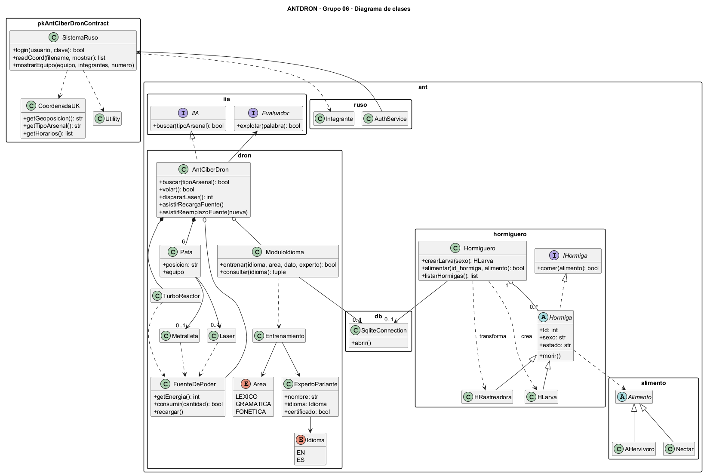
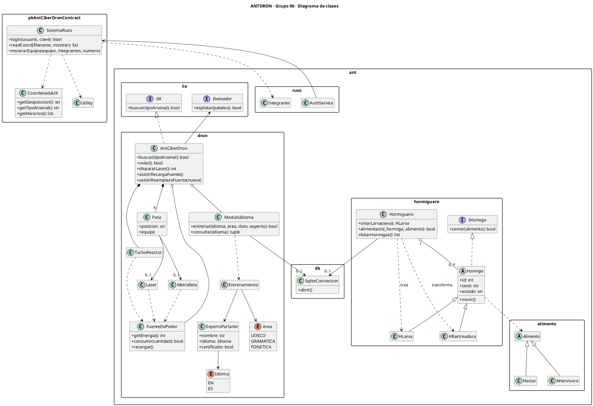

# Grupo 06 · Diagrama de clases

El diagrama cubre la Parte 3 y los contratos que usa durante la integración. Ronny proporciona la implementación de `Evaluador`; Mateo conecta el menú con `Hormiguero` y `ModuloIdioma`.

