# Diagrama Obligatorio 1: Diagrama de Clases UML (Python 3.12 · PlantUML)

> **Responsable (Parte 3):** **Oscar Tamayo (`I2`)**  
> Alineado al **100% con el contrato oficial `pkAntCiberDronContract` del PDF** e implementado en **Python 3.12** (`abc.ABC`, `@abstractmethod` y tipado estático):
> - `IHormiga.comer(self, a: Alimento) -> bool`
> - `Hormiga` con `- Id: int`, `- sexo: str`, `- estado: str`, `__init__()` y `__str__()` (equivalente a `toString()`)
> - **`AntCiberDron` implementa `IIA`** (`+ buscar(self, tipoArsenal: str) -> bool`)
> - Inclusión de `CoordenadaUK`, `Utility`, `SistemaRuso.readCoord(self, filename: str) -> list[CoordenadaUK]` y extremidades/armas/idiomas completos.

```plantuml
@startuml
title Diagrama de Clases UML — ANTDRON / AntCiberDron (Python 3.12)
skinparam classAttributeIconSize 0
skinparam packageStyle rectangle

package "pkAntCiberDronContract (Python 3.12)" {
  interface IHormiga <<abc.ABC>> {
    + {abstract} comer(a: Alimento): bool
  }
  interface IIA <<abc.ABC>> {
    + {abstract} buscar(tipoArsenal: str): bool
  }
  class CoordenadaUK {
    - geoposicion: str
    - lunes: str
    - martes: str
    - miercoles: str
    - jueves: str
    - viernes: str
    - tipoArsenal: str
    + get_geoposicion(): str
    + get_tipo_arsenal(): str
  }
  class Utility {
    + {static} mostrarLoading(delay_ms: int): None
    + {static} formatearFila(c: CoordenadaUK): str
  }
  class SistemaRuso {
    + login(usuario: str, clave: str): bool
    + readCoord(filename: str): list[CoordenadaUK]
    + mostrarEquipo(equipo: str, integrantes: list): None
    + evaluarDestruccion(dron: AntCiberDron, coords: list[CoordenadaUK]): None
  }
}

package "ant.hormiguero" {
  abstract class Hormiga <<abc.ABC>> {
    - Id: int
    - sexo: str
    - estado: str
    + __init__()
    + {abstract} comer(a: Alimento): bool
    + morir(): None
    + __str__(): str
  }
  class HLarva {
    - estrategia: EvolucionStrategy
    + __init__()
    + comer(a: Alimento): bool
    + evolucionar(): Hormiga
  }
  class HSoldado {
    + __init__()
    + comer(a: Alimento): bool
  }
  class HZangano {
    + __init__()
    + comer(a: Alimento): bool
  }
  class HRastreadora {
    + __init__()
    + comer(a: Alimento): bool
  }
  interface EvolucionStrategy <<abc.ABC>> {
    + {abstract} alimentoRequerido(): Alimento
    + {abstract} crearHormiga(id: int, sexo: str): Hormiga
  }
  class Hormiguero {
    - hormigas: list[Hormiga]
    + crearLarva(sexo: str): HLarva
    + alimentar(id_hormiga: int, a: Alimento): bool
    + listarHormigas(): list[Hormiga]
  }
}

package "ant.alimento" {
  abstract class Alimento <<abc.ABC>> {
    + __init__()
    + __str__(): str
  }
  class Nectar
  class ACarnivoro
  class AOmnivoro
  class AHervivoro
}

package "ant.iia" {
  class BombaAutomata {
    - estadoInicial: str
    - estadosAceptacion: set[str]
    + aceptar(cadena: str): bool
  }
}

package "ant.dron" {
  class AntCiberDron {
    - id: int
    - patas: list[Pata]
    - metralletaDelanteraDer: Metralleta
    - laserDelanteroIzq: Laser
    - turboEspalda: TurboReactor
    - fuente: FuenteDePoder
    - bomba: BombaAutomata
    - moduloIdioma: ModuloIdioma
    + buscar(tipoArsenal: str): bool
    + volar(): bool
    + dispararMetralleta(): None
    + dispararLaser(): int
    + asistirRecargaFuente(): None
    + asistirReemplazoFuente(nueva: FuenteDePoder): None
  }
  class FuenteDePoder {
    - energia: int
    - operativa: bool
    + recargar(): None
    + consumir(cantidad: int): bool
    + getEnergia(): int
  }
  class Laser {
    + calcularPotencia(f: FuenteDePoder): int
  }
  class Metralleta
  class TurboReactor {
    + activarVuelo(f: FuenteDePoder): bool
  }
  class Pata {
    - posicion: str
    - armaEquipada: str
  }
  class ModuloIdioma {
    - lexico: dict
    - gramatica: list
    - fonetica: list
    + entrenar(area: str, dato: str, experto: ExpertoParlante): bool
  }
  class ExpertoParlante {
    - nombre: str
    - idioma: str
    - certificado: bool
  }
}

IHormiga <|.. Hormiga
Hormiga <|-- HLarva
Hormiga <|-- HSoldado
Hormiga <|-- HZangano
Hormiga <|-- HRastreadora
HLarva --> EvolucionStrategy
Alimento <|-- Nectar
Alimento <|-- ACarnivoro
Alimento <|-- AOmnivoro
Alimento <|-- AHervivoro
IIA <|.. AntCiberDron
AntCiberDron *-- BombaAutomata
AntCiberDron *-- FuenteDePoder
AntCiberDron *-- Laser
AntCiberDron *-- Metralleta
AntCiberDron *-- TurboReactor
AntCiberDron *-- Pata
AntCiberDron *-- ModuloIdioma
ModuloIdioma --> ExpertoParlante
Hormiguero o-- Hormiga
SistemaRuso --> CoordenadaUK
SistemaRuso --> Utility
SistemaRuso --> AntCiberDron
@enduml
```

