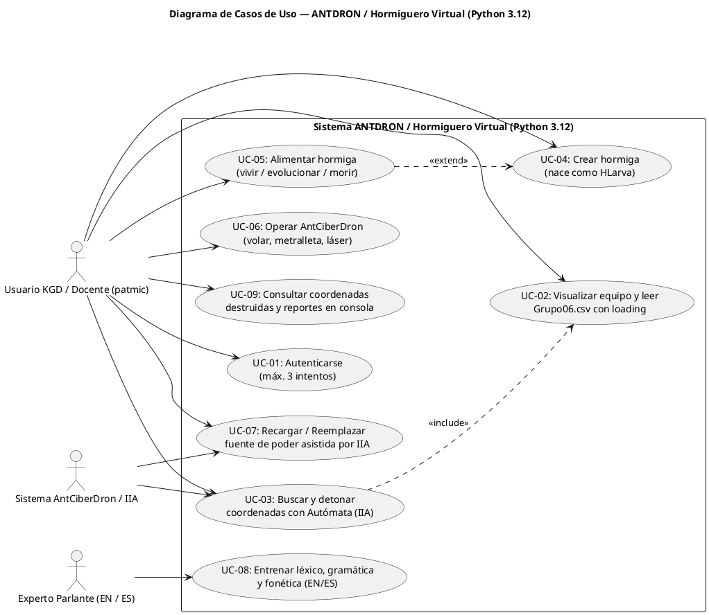

# Diagrama Obligatorio 2: Diagrama de Casos de Uso (Python 3.12 · PlantUML)

> **Responsable (Parte 1):** **Analy Yepez (`I1`)**  
> **Brecha resuelta:** Este diagrama era obligatorio en el cuestionario del PDF pero no había sido incluido en `WORKSHOP-XP.md`. Implementado sobre consola interactiva y persistencia SQLite en **Python 3.12**.

## Especificación Resumida de Actores
- **Usuario KGD / Docente (`patmic`):** Inicia sesión en la consola Python, carga el archivo ucraniano `Grupo06.csv`, opera el Hormiguero Virtual (crea/alimenta hormigas), consulta objetivos destruidos y controla el dron.
- **Experto Parlante (Inglés / Español):** Único actor autorizado (`ExpertoParlante`) para proveer datos de entrenamiento en léxico, gramática y fonética.
- **AntCiberDron / IIA:** Evalúa el autómata en Python (`BombaAutomata`) para decidir detonación y asiste en la recarga o reemplazo de la fuente de poder.
