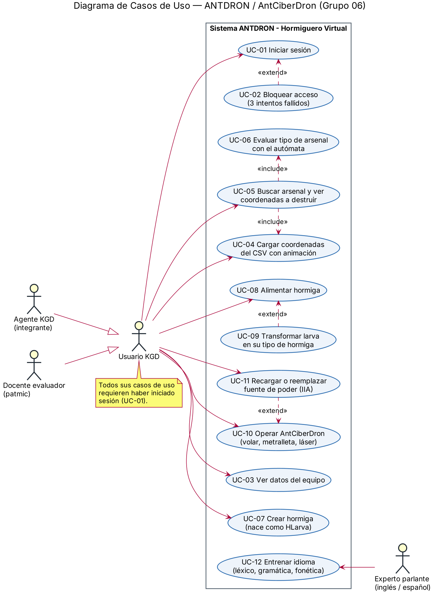

# Diagrama Obligatorio 2: Diagrama de Casos de Uso (Python 3.12 · PlantUML)

> **Responsable (Parte 1):** **Analy Yepez (`I3`)**

Fuente editable: [`img/02-casos-de-uso.puml`](img/02-casos-de-uso.puml) (PlantUML).

## Actores
| Actor | Descripción |
| :--- | :--- |
| **Usuario KGD** | Actor general que usa el sistema después de iniciar sesión. |
| **Agente KGD (integrante)** | Cada uno de los 4 integrantes del Grupo 06. Hereda de Usuario KGD. |
| **Docente evaluador (`patmic`)** | Accede con `patmic` / `123` para revisar el sistema. Hereda de Usuario KGD. |
| **Experto parlante (inglés / español)** | Único actor autorizado para entrenar léxico, gramática y fonética del AntCiberDron. |

## Casos de uso
| ID | Caso de uso | Actor | Relación | HU |
| :--- | :--- | :--- | :--- | :--- |
| UC-01 | Iniciar sesión (máx. 3 intentos) | Usuario KGD | — | HU-01 |
| UC-02 | Bloquear acceso tras 3 intentos fallidos | — | `<<extend>>` UC-01 | HU-01 |
| UC-03 | Ver datos del equipo (`[+] TEAM [6]`) | Usuario KGD | — | HU-02 |
| UC-04 | Cargar coordenadas de `Grupo06.csv` con animación | Usuario KGD | — | HU-02 |
| UC-05 | Buscar arsenal y ver coordenadas a destruir | Usuario KGD | `<<include>>` UC-04 y UC-06 | HU-03 |
| UC-06 | Evaluar tipo de arsenal con el autómata | — | Incluido por UC-05 | HU-03 |
| UC-07 | Crear hormiga (nace como `HLarva`) | Usuario KGD | — | HU-04 |
| UC-08 | Alimentar hormiga | Usuario KGD | — | HU-04, HU-05 |
| UC-09 | Transformar larva en su tipo de hormiga | — | `<<extend>>` UC-08 | HU-05 |
| UC-10 | Operar AntCiberDron (volar, metralleta, láser) | Usuario KGD | — | HU-06 |
| UC-11 | Recargar o reemplazar la fuente de poder con asistencia del IIA | Usuario KGD | `<<extend>>` UC-10 | HU-07 |
| UC-12 | Entrenar idioma (léxico, gramática, fonética) | Experto parlante | — | HU-08 |

## Notas
- Todos los casos de uso del Usuario KGD requieren haber iniciado sesión (UC-01).
- `<<include>>`: el caso base siempre ejecuta el caso incluido (buscar arsenal siempre carga el CSV y evalúa con el autómata).
- `<<extend>>`: comportamiento opcional que ocurre solo bajo una condición (bloqueo tras 3 fallos, transformación si la larva come su alimento, recarga cuando la energía se agota).
