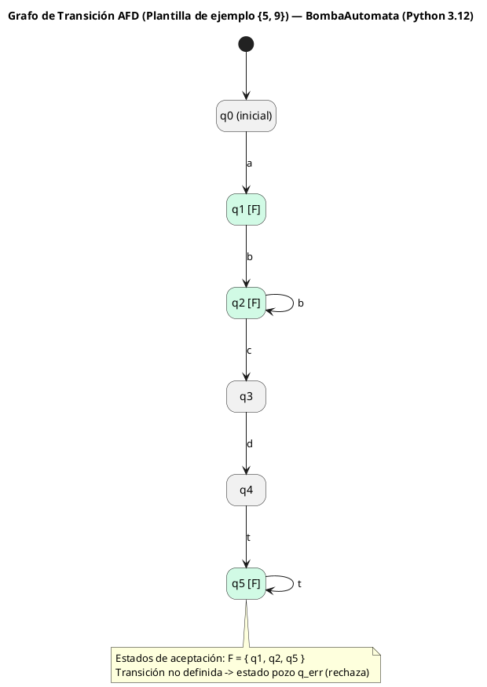

# Diagrama Obligatorio 3: Autómata de la Bomba (Definición Formal, Grafo PlantUML y Gramática — Python 3.12)

> **Regla oficial del PDF:**  
> Se toma el **último dígito de la cédula de cada integrante del equipo** (4 integrantes $\rightarrow$ hasta 4 coordenadas distintas).  
> El lenguaje $L$ de la bomba es la **unión de los lenguajes** correspondientes a esos dígitos en la tabla oficial de la OTAN/Ucrania.  
> En **Python 3.12**, `BombaAutomata` implementa la tabla de transición $\delta$ mediante diccionarios y estados propios (sin usar `re.fullmatch` en producción; el módulo `re` se utiliza únicamente como oráculo en las pruebas `pytest`).

---

## 1. Tabla de Referencia Oficial (Coordenada $\leftrightarrow$ Lenguaje)

| Último dígito | Coordenada | Horario oficial | Lenguaje ($L_i$) | Significado de Arsenal ($\Sigma = \{a,b,c,d,t\}$) |
| :---: | :---: | :--- | :--- | :--- |
| `0` | `Coord-00` | *(sin horario)* | `a+` | Uno o más Aviones (`a`) |
| `1` | `Coord-01` | Lunes `01-02` | `a+` | Uno o más Aviones (`a`) |
| `2` | `Coord-02` | Martes `02-04` | `ab*` | Avión seguido de cero o más Barcos (`b`) |
| `3` | `Coord-03` | Miércoles `03-06` | `abc` | Avión + Barco + Convoy (`c`) |
| `4` | `Coord-04` | Jueves `04-08` | `abcd*` | Avión + Barco + Convoy + cero o más Drones (`d`) |
| `5` | `Coord-05` | Viernes `05-10` | `abcdt+` | Avión + Barco + Convoy + Dron + uno o más Tanques (`t`) |
| `6` | `Coord-06` | Jueves `04-08` | `abcdt+` | Avión + Barco + Convoy + Dron + uno o más Tanques (`t`) |
| `7` | `Coord-07` | Miércoles `03-06` | `abcd*` | Avión + Barco + Convoy + cero o más Drones (`d`) |
| `8` | `Coord-08` | Martes `02-04` | `abc` | Avión + Barco + Convoy (`c`) |
| `9` | `Coord-09` | Lunes `01-02` | `ab*` | Avión seguido de cero o más Barcos (`b`) |

---

## 2. Datos del Equipo (COMPLETAR CON LAS 4 CÉDULAS REALES)

- **Último dígito I1:** `[D1]` $\rightarrow$ `Coord-0[D1]` $\rightarrow$ `[L1]`
- **Último dígito I2:** `[D2]` $\rightarrow$ `Coord-0[D2]` $\rightarrow$ `[L2]`
- **Último dígito I3:** `[D3]` $\rightarrow$ `Coord-0[D3]` $\rightarrow$ `[L3]`
- **Último dígito I4:** `[D4]` $\rightarrow$ `Coord-0[D4]` $\rightarrow$ `[L4]`
- **Lenguaje Unido Resultante:** $L = \{ \text{[L1]}, \text{[L2]}, \text{[L3]}, \text{[L4]} \}$ *(eliminando duplicados)*.

---

## 3. Plantilla Formal $A = (Q, \Sigma, \delta, q_0, F)$ — *(Ejemplo guía con dígitos `{5, 9}` del PDF)*

> **Nota:** Al implementar con las 4 cédulas reales, reemplazar $Q$, $\delta$, $F$, el Grafo PlantUML y la Gramática exactamente según la unión obtenida de `[D1..D4]`.

- **Ejemplo de referencia PDF ($L = \{ \text{abcdt}^+, \text{ab}^* \}$):**
  - $\Sigma = \{ a, b, c, d, t \}$
  - $Q = \{ q_0, q_1, q_2, q_3, q_4, q_5, q_{\text{err}} \}$
  - Estado inicial: $q_0$
  - Estados de aceptación: $F = \{ q_1, q_2, q_5 \}$
    - `q1` acepta `a` (caso `ab*` con 0 `b`s).
    - `q2` acepta `ab+` (caso `ab*` con 1+ `b`s).
    - `q5` acepta `abcdt+`.

### Grafo de Transición (PlantUML — Plantilla de ejemplo `{5, 9}`)

*(En el AFD total, toda transición no indicada va al estado pozo $q_{\text{err}}$).*

### Gramática Regular Equivalente $G = (V_N, V_T, P, S)$ — *(Ejemplo `{5, 9}`)*
- $V_N = \{ S, A, B, C, D, E \}$, $V_T = \{ a, b, c, d, t \}$, $S = q_0$
- Producciones $P$:
  - $S \rightarrow aA \mid a$ *(acepta `a`)*
  - $A \rightarrow bA \mid b \mid bB$ *(acepta `ab*` y continúa hacia `abc...`)*
  - $B \rightarrow cC$
  - $C \rightarrow dD$
  - $D \rightarrow tE \mid t$
  - $E \rightarrow tE \mid t$
