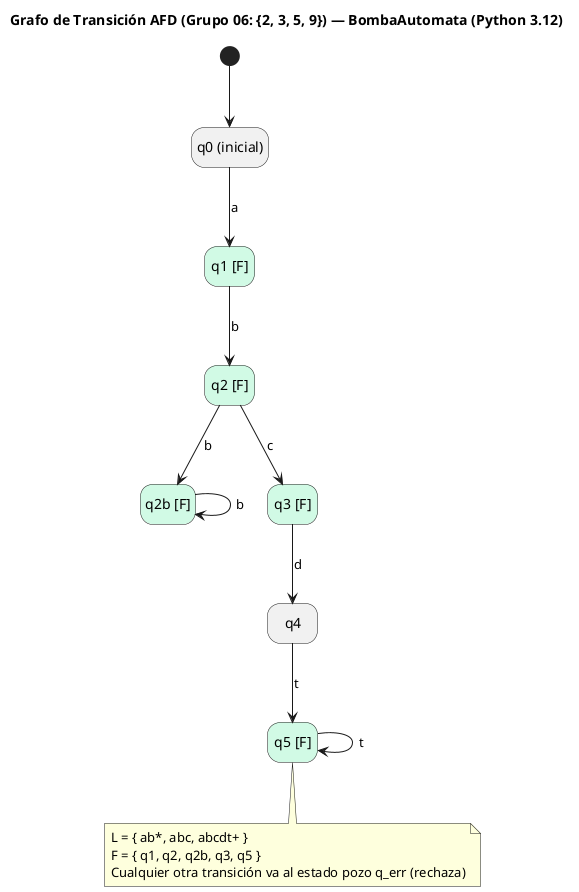

# Diagrama Obligatorio 3: Autómata de la Bomba (Definición Formal, Grafo PlantUML y Gramática — Python 3.12)

> **Responsable (Parte 2):** **Ronny Veloz (`I1` · Cliente + Gestor)** · **Historias de Usuario asociadas:** **`HU-03`** *(Bomba Inteligente con Autómata)* y **`HU-11`** *(5 Diagramas Obligatorios y Documento Final)*  
> **Regla oficial del PDF:**  
> Se toma el **último dígito de la cédula de cada integrante del equipo** (4 integrantes $\rightarrow$ hasta 4 coordenadas distintas).  
> El lenguaje $L$ de la bomba es la **unión de los lenguajes** correspondientes a esos dígitos en la tabla oficial de la OTAN/Ucrania.  
> En **Python 3.12**, `BombaAutomata` implementa la tabla de transición $\delta$ mediante diccionarios y estados propios (sin usar `re.fullmatch` en producción; el módulo `re` se utiliza únicamente como oráculo en las pruebas `pytest`).

---

## 1. Tabla de Referencia Oficial (Coordenada $\leftrightarrow$ Lenguaje)

| Último dígito | Coordenada | Horario oficial | Lenguaje ($L_i$) | Significado de Arsenal ($\Sigma = \{a,b,c,d,t\}$) |
| :---: | :---: | :--- | :--- | :--- |
| `0` | `Coord-00` | *(sin horario)* | `a+` | Uno o más Aviones (`a`) |
| `1` | `Coord-01` | Lunes `01-02` | `a+` | Uno o más Aviones (`a`) |
| `2` | `Coord-02` | Martes `02-04` | `ab*` | Avión seguido de cero o más Barcos (`b`) |
| `3` | `Coord-03` | Miércoles `03-06` | `abc` | Avión + Barco + Convoy (`c`) |
| `4` | `Coord-04` | Jueves `04-08` | `abcd*` | Avión + Barco + Convoy + cero o más Drones (`d`) |
| `5` | `Coord-05` | Viernes `05-10` | `abcdt+` | Avión + Barco + Convoy + Dron + uno o más Tanques (`t`) |
| `6` | `Coord-06` | Jueves `04-08` | `abcdt+` | Avión + Barco + Convoy + Dron + uno o más Tanques (`t`) |
| `7` | `Coord-07` | Miércoles `03-06` | `abcd*` | Avión + Barco + Convoy + cero o más Drones (`d`) |
| `8` | `Coord-08` | Martes `02-04` | `abc` | Avión + Barco + Convoy (`c`) |
| `9` | `Coord-09` | Lunes `01-02` | `ab*` | Avión seguido de cero o más Barcos (`b`) |

---

## 2. Datos Reales del Equipo (Grupo 06)

- **I3 · Analy Yepez (`1721396412`):** último dígito **`2`** $\rightarrow$ `Coord-02` (Martes `02-04`) $\rightarrow$ **`ab*`**
- **I1 · Ronny Veloz (`1724490055`):** último dígito **`5`** $\rightarrow$ `Coord-05` (Viernes `05-10`) $\rightarrow$ **`abcdt+`**
- **I2 · Oscar Tamayo (`1722578703`):** último dígito **`3`** $\rightarrow$ `Coord-03` (Miércoles `03-06`) $\rightarrow$ **`abc`**
- **I4 · Mateo Yaguari (`1726389099`):** último dígito **`9`** $\rightarrow$ `Coord-09` (Lunes `01-02`) $\rightarrow$ **`ab*`**
- **Lenguaje Unido Resultante (dígitos `{2, 3, 5, 9}`):**
  $$L = \{ \text{ab}^*, \; \text{abc}, \; \text{abcdt}^+ \}$$

---

## 3. Definición Formal del AFD $A = (Q, \Sigma, \delta, q_0, F)$

- **Alfabeto:** $\Sigma = \{ a, b, c, d, t \}$
- **Conjunto de Estados:** $Q = \{ q_0, q_1, q_2, q_{2b}, q_3, q_4, q_5, q_{\text{err}} \}$
- **Estado Inicial:** $q_0$
- **Estados de Aceptación:** $F = \{ q_1, q_2, q_{2b}, q_3, q_5 \}$
  - `q1` acepta `a` (`ab*` con 0 `b`s).
  - `q2` acepta `ab` (`ab*` con 1 `b`, y permite avanzar a `c` para `abc` / `abcdt+`).
  - `q2b` acepta `abb+` (`ab*` con $\ge 2$ `b`s; impide aceptar palabras inválidas como `abbc`).
  - `q3` acepta `abc` (y permite avanzar a `d` hacia `abcdt+`).
  - `q4` es estado intermedio para `abcd` (**no** acepta, ya que `abcd*` no pertenece a `{2, 3, 5, 9}`).
  - `q5` acepta `abcdt+`.

### Tabla de Transición $\delta$

| Estado | `a` | `b` | `c` | `d` | `t` | ¿Acepta? |
| :--- | :---: | :---: | :---: | :---: | :---: | :---: |
| **`q0` *(inicial)*** | `q1` | `q_err` | `q_err` | `q_err` | `q_err` | No |
| **`q1`** | `q_err` | `q2` | `q_err` | `q_err` | `q_err` | **Sí** (`a`) |
| **`q2`** | `q_err` | `q2b` | `q3` | `q_err` | `q_err` | **Sí** (`ab`) |
| **`q2b`** | `q_err` | `q2b` | `q_err` | `q_err` | `q_err` | **Sí** (`abb+`) |
| **`q3`** | `q_err` | `q_err` | `q_err` | `q4` | `q_err` | **Sí** (`abc`) |
| **`q4`** | `q_err` | `q_err` | `q_err` | `q_err` | `q5` | No |
| **`q5`** | `q_err` | `q_err` | `q_err` | `q_err` | `q5` | **Sí** (`abcdt+`) |
| **`q_err` *(pozo)*** | `q_err` | `q_err` | `q_err` | `q_err` | `q_err` | No |

### Grafo de Transición (PlantUML — Cédulas `{2, 3, 5, 9}`)

Fuente editable adicional: [`img/03-automata.puml`](img/03-automata.puml).

*(En el AFD total implementado en `BombaAutomata`, toda transición no indicada va al estado pozo $q_{\text{err}}$).*

### Gramática Regular Equivalente $G = (V_N, V_T, P, S)$
- $V_N = \{ S, A, B, B_2, C, D, E \}$ *(correspondientes a $q_0, q_1, q_2, q_{2b}, q_3, q_4, q_5$)*
- $V_T = \{ a, b, c, d, t \}$
- Símbolo inicial: $S$
- Producciones $P$:
  - $S \rightarrow aA \mid a$ *(acepta `a`)*
  - $A \rightarrow bB \mid b$ *(acepta `ab`)*
  - $B \rightarrow bB_2 \mid b \mid cC \mid c$ *(desde `ab`: deriva `abb+` o acepta `abc`)*
  - $B_2 \rightarrow bB_2 \mid b$ *(acepta `abb+`)*
  - $C \rightarrow dD$ *(desde `abc`, exige `d` para avanzar a `abcdt+`)*
  - $D \rightarrow tE \mid t$ *(acepta `abcdt`)*
  - $E \rightarrow tE \mid t$ *(acepta `abcdt+`)*

---

## 4. Implementación en Python 3.12 (`src/ant/iia/`)

- **`BombaAutomata` / `Automata`** ([`src/ant/iia/bomba_automata.py`](../../src/ant/iia/bomba_automata.py)):
  - `aceptar(cadena: str) -> bool` y `evaluar(palabra: str) -> bool`: recorren la tabla $\delta$ carácter por carácter sin usar `re`.
  - `recorrido(cadena: str) -> list[str]`: devuelve la traza de estados visitados desde `q0`.
- **`Bomba` y `mostrar_destruir`** ([`src/ant/iia/bomba.py`](../../src/ant/iia/bomba.py)):
  - `Bomba(automata).explotar(palabra: str) -> bool` (y alias `buscar(tipoArsenal: str) -> bool`).
  - `mostrar_destruir(coordenadas, evaluador=None) -> list[CoordenadaUK]`: imprime la tabla `COORDENADAS UCRANIANAS A DESTRUIR` y retorna las 29 filas detonadas de `data/Grupo06.csv`.
