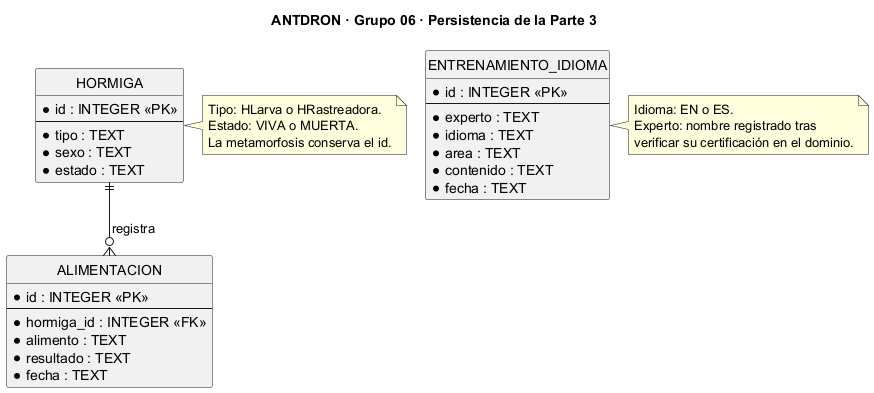
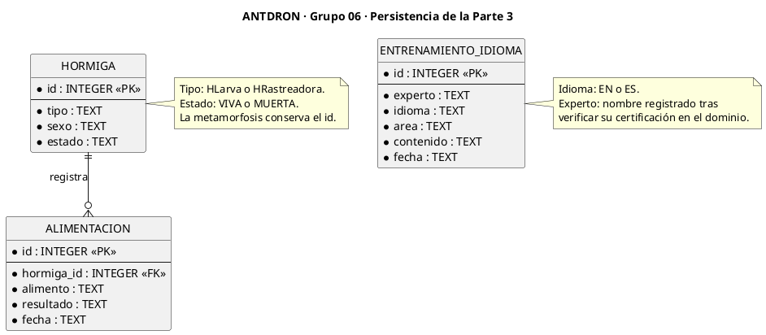

# Grupo 06 · Modelo entidad-relación

El modelo describe las tablas SQLite implementadas por la Parte 3. La base de datos representa un hormiguero virtual y un registro de entrenamiento para el grupo. La autenticación y las coordenadas siguen usando las fuentes de la Parte 1.

