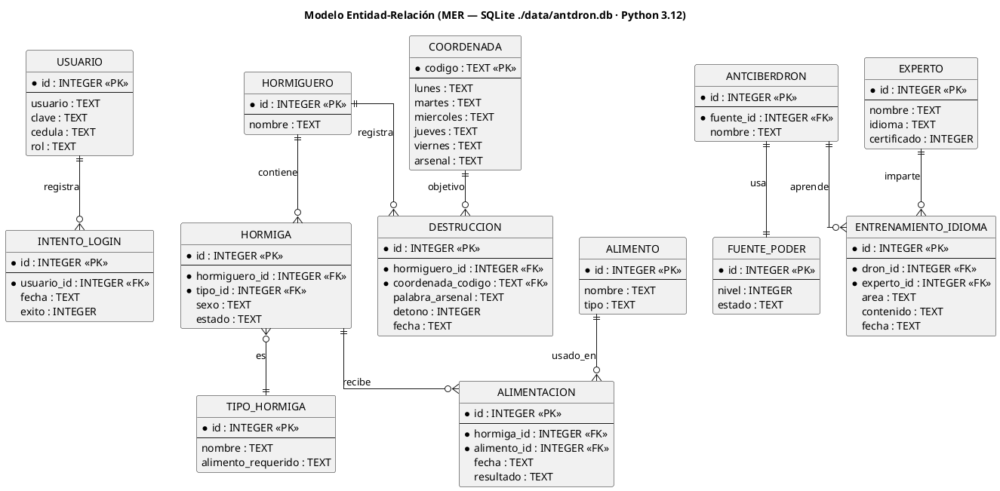

# Diagrama Obligatorio 4: Modelo Entidad-Relación (MER — SQLite en Python 3.12 · PlantUML)

> **Responsable (Parte 3):** **Oscar Tamayo (`I3`)**  
> Base de datos embebida **SQLite** ubicada en `./data/antdron.db`, gestionada desde **Python 3.12** mediante el módulo estándar `sqlite3` (`src/ant/db/`), alineada con el dominio del PDF y `WORKSHOP-XP.md`.

